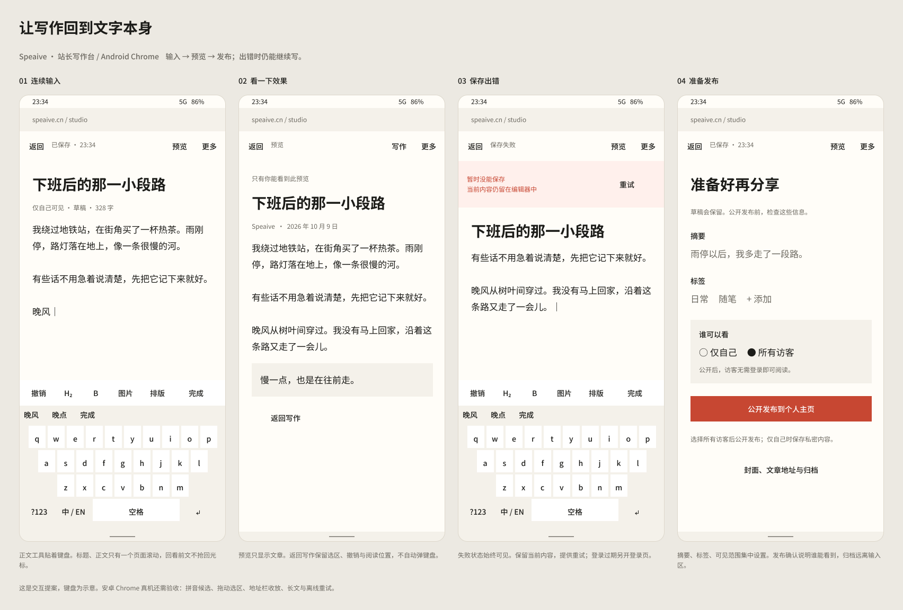
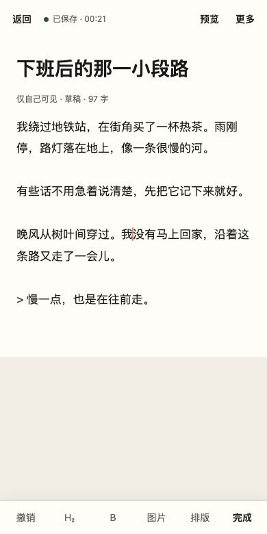
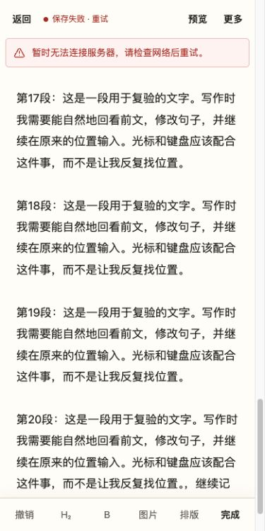

# 站长手机写作评审与改版方案

日期：2026-10-10。入口：`/studio/new/`、`/studio/edit/:slug/`。目标设备：安卓 Chrome。重点是输入、光标、键盘与长文保存。

## 产品判断

此前的改动把桌面编辑器缩小、拆成三个视图，解决了首屏拥挤和嵌套滚动，但没有完整定义「正在输入」「回看前文」「修改标题」「保存出错」之间的行为。用户觉得奇怪有具体原因，继续加按钮或改颜色解决不了这些问题。

写作页的主要任务是把文字写完，并知道它是否保存。排版工具跟随正文的编辑目标；预览不抢焦点；发布与归档需要离开正文输入区。现有 Markdown 存储和 CodeMirror 撤销记录可以保留，暂时没有充分证据支持更换编辑器。

## Code review 结论

使用 Codex 专用 `review`，以 `1e5fc37` 为基线审阅最近两轮手机写作改动。第一轮通用评审没有给出确认问题；随后结合浏览器复现，针对视口、焦点和保存路径做了专项评审，确认以下三项。评审本身只读，修复由本轮开发完成。

| 优先级 | 问题与触发方式 | 本轮处理 |
| --- | --- | --- |
| P1 | 正文焦点留在文末，用户滚回前文；任意 resize 都按文末光标滚动。旧代码在 390×844 → 390×812 时，`keyboardOpen=false`，仍从 1116 跳到 2823。 | 只有键盘遮挡造成可视底边缩小时才避让；已在旧可视区外的光标不追回。缩放、输入法组合输入、失焦、键盘收起均不强制定位。 |
| P2 | 手机命令栏改为 static，长文底部看不到保存失败、重新登录或手动保存。已发布文章也不能靠草稿自动保存。 | 保存状态、保存或更新入口、视图切换及错误提示组成吸顶区域。草稿的发布、撤回、归档集中在设置视图；已发布文章的更新确认继续保留。 |
| P2 | 正文选区保留后转去编辑标题，再点排版按钮，工具修改旧正文选区并把焦点拉回正文。站长、会员都有此路径。 | 共享编辑目标跟踪；编辑标题或其他字段时隐藏手机正文工具，并拒绝正文格式操作。正文通过 Tab 到工具按钮仍可操作。 |

断网复验另外发现浏览器异常直接显示 `Failed to fetch`。请求层现在把网络失败转换成中文提示，令牌获取失败后清掉失败的缓存，恢复网络可以重新保存。正文不会因失败被替换。

实现后的第二轮专项 review 确认二级排版菜单被父层横向滚动裁切，已解除手机工具栏的裁切。复验同时发现隐藏标题在 resize 时高度被写成零，已跳过隐藏状态的测量。最后一次 ultra 只读复审发现 VisualViewport 平移后，下一次 resize 仍使用旧范围判断光标；现在 scroll 更新当前范围，同一帧的多次 resize 保留第一次缩小前的快照，配套通知不会抹掉应有的避让。该边界通过内存模拟与回归测试验证，不算安卓真机复现。

## 已交付的设计稿

[Figma：安卓手机写作方案](https://www.figma.com/design/qhJhEGJu1dHmSyIHCJn19d?node-id=2-326)

四个 390×844 的状态：连续输入、文章预览、保存失败、发布设置。使用可编辑文字、自动布局、组件实例和博客色彩变量；没有把整页截图作为设计层。正文与中文界面使用 Noto Sans SC 表达 Android 中文字体回退，Material 按钮作为组件基础，保留博客纸色、深色文字和红色强调。

四个状态的核心布局已经实现：56 px 顶部栏提供返回、保存状态、预览和更多；正文工具收紧为撤销、二级标题、加粗、图片、排版和完成。标签和可见范围使用可操作的原生控件。提案中的浏览器栏、中文候选和键盘只用于说明，不会绘制到网站，也不代表 Gboard 或安卓真机实测。

## 已实现的交互

- 写作页默认只显示标题、文字和必要反馈，正文随文章长度展开；17 px 系统字体、单层页面滚动、48 px 工具点击区域。
- 预览使用独立标题、日期和排版正文；进入时收起输入焦点，返回不主动弹键盘。记录实际可见段落位置，重新显示后有限次测量修正高度，不改变选区与撤销历史；用户开始新的滚动手势会取消恢复。
- “更多”显示摘要、标签、谁可以看与保存或发布。封面、地址、时间、撤回与归档，以及版本、分享、AI 工具分别折叠，按需展开。
- “保存私密草稿”保持草稿状态。公开发布、更新已发布文章、撤回与归档使用页面内的确认对话框；取消或 Escape 不提交。对话框有中文说明和明确的确认按钮。
- 保存状态与错误提示吸顶；断网不替换正文，恢复后可以点击同一入口重试。

[真实文章预览](screenshots/studio-mobile-preview.jpg) · [真实发布设置](screenshots/studio-mobile-settings.jpg) · [公开发布确认](screenshots/studio-mobile-publication-confirm.jpg)

## 验证与剩余工作

本轮前端 94 项测试通过，类型检查和生产构建通过。保留两项已有弃用提示：Safari 输入法兼容中的 `keyCode`、会员编辑器原生撤销兼容中的 `execCommand`。

新增回归覆盖：非键盘 resize、键盘遮住原本可见光标、回看前文时键盘打开、键盘收起、组合输入、页面缩放、失焦、同时收到窗口与 VisualViewport 通知、视口平移后再缩小、resize 配套 scroll、隐藏标题测量、长文阅读锚点与手势取消、正文与标题之间的工具目标，以及断网恢复保存。

独立本地数据库、演示账号与合成文章完成浏览器实操：中文选区加粗后焦点仍在正文，撤销可还原；二级排版菜单可点击；长标题在设置中 resize 后返回不会消失；320 px 窗口无整页横向溢出。私密草稿保存、公开发布的取消与 Escape、确认发布和撤回均已验证，测试文章最终恢复为仅自己可见的草稿。

长文通过原生点按复验：预览前后第 17 段顶部均为 78 px；另一轮设置返回，第 15 段顶部均为 125.625 px；返回后焦点为页面，不强制打开键盘。验收比较实际可见段落和位置，不仅比较 scrollY。自动化 locator 的点击会预先滚动吸顶按钮，不能把这一额外动作误判为用户点按后的恢复偏移。

新版断网实测：滚动位置为 2607 px，错误提示仍在视口顶部 56 px，保存按钮顶部 4 px；恢复网络后状态变为「已保存」，错误消失。断网模拟已关闭。

安卓 Chrome 真机仍需验收：

1. 拼音候选确认和连续输入，不丢字、不误触格式。
2. 长按选词、拖动选区手柄，工具操作后继续输入。
3. 地址栏收放、键盘开关、横竖屏与系统字体放大。
4. 千字长文回看前文、修改末行、预览后返回原位。
5. 网络中断、登录过期、版本冲突时，提示可见，正文保留，恢复后可处理。

当前已完成代码与桌面浏览器手机尺寸验收。真实安卓 Chrome 的拼音输入法、软键盘和原生选区手柄仍未验收，不能宣称真机通过。本轮未部署线上。

## 适合补充的技能与方法

[pm-skills](https://github.com/phuryn/pm-skills) 中的用户旅程、PRD 与测试场景工作流适合本项目：先按输入、回看、排版、预览、保存、发布逐步分析，再把每步的预期行为变成验收条件。优先用这三个小工作流即可，没有必要一次安装整个技能集合。本轮未安装第三方技能。

[frontend-design](https://github.com/anthropics/skills/tree/main/skills/frontend-design) 可帮助统一视觉方向与布局，但无法替代真实手机上的输入法、软键盘和选区验证。Figma 适合把状态和交互摆出来共同评审，code review 适合找代码路径问题，二者都需要浏览器和真机证据。

代码入口：`src/lib/studio/mobile-writing.ts` 管视口、阅读位置与视图；`src/lib/writing/body-tools.ts` 管编辑目标；`src/lib/studio/confirmation.ts` 管确认对话框；`src/styles/studio-mobile-writing.css` 管手机布局；`src/components/EditorForm.astro` 保留保存、发布和版本控制流程。
